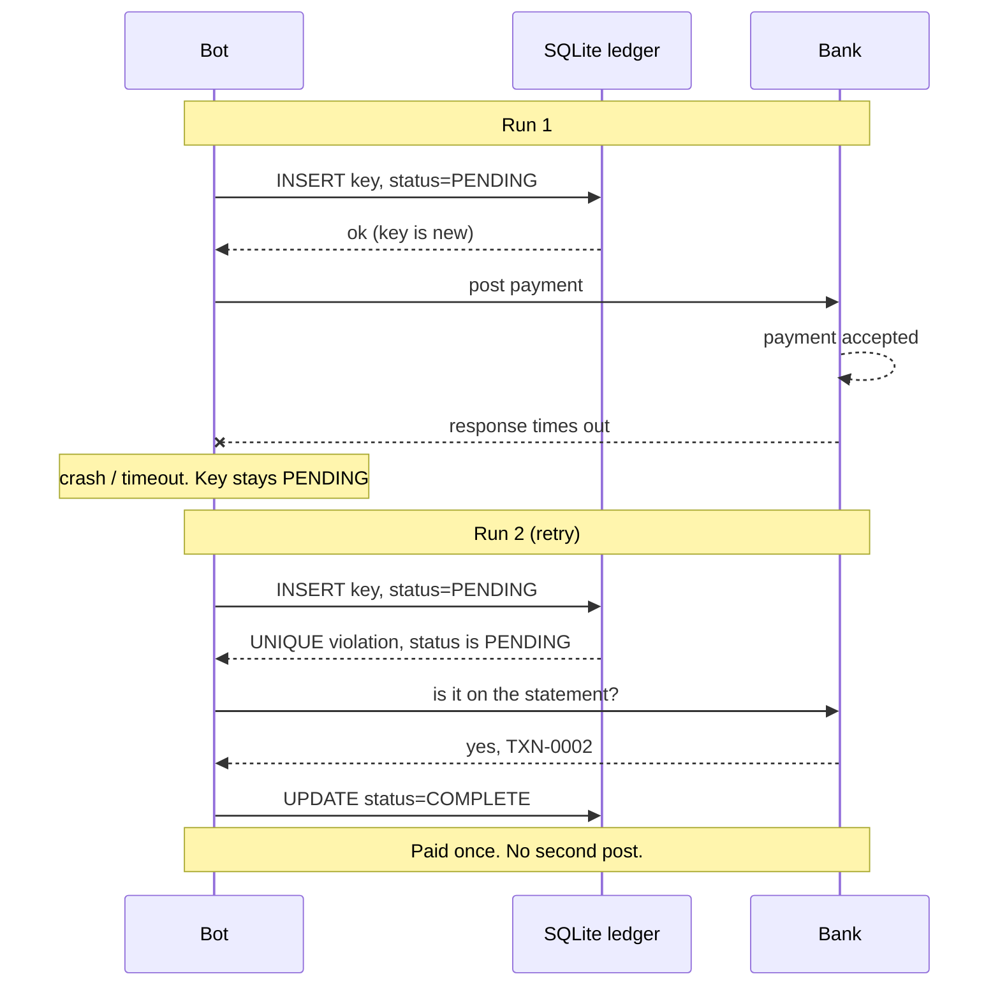
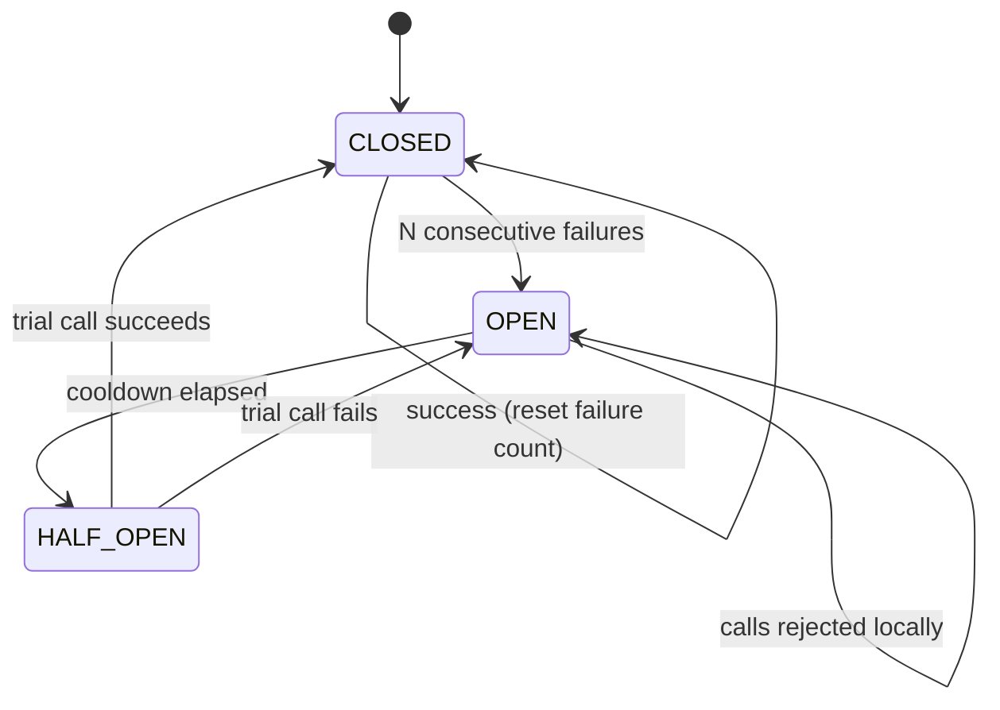

# idempotent-automation-patterns

Three reliability patterns I use in production finance and operations bots,
rewritten as small, standard-library-only Python with runnable demos and tests.

These failures don't come from bad logic. A bot can do everything right and
still post a payment twice, restart a 32-facility run from scratch, or keep
hitting an API that has already gone down. Each pattern below starts with that
kind of failure, then shows the fix.

| Pattern | Problem it solves | Code | Demo |
|---|---|---|---|
| [Idempotency ledger](#1-idempotency-ledger) | Retries create duplicate payments | [`patterns/idempotency.py`](patterns/idempotency.py) | `python -m examples.payment_posting` |
| [Classified retries + checkpoints](#2-retry-with-error-classification--checkpoints) | Every error gets handled the same way; one failure restarts the whole run | [`patterns/retry.py`](patterns/retry.py), [`patterns/checkpoint.py`](patterns/checkpoint.py) | `python -m examples.facility_report` |
| [Circuit breaker + streaming](#3-circuit-breaker--streaming-ingestion) | Retries flood a dependency that is down; large files don't fit in memory | [`patterns/circuit_breaker.py`](patterns/circuit_breaker.py), [`patterns/checkpoint.py`](patterns/checkpoint.py) | `python -m examples.streaming_ingest` |

All data in this repo is synthetic. The bank, facilities and API are deterministic fakes
([`examples/fakes.py`](examples/fakes.py)).

## Quick start

Requires Python 3.11+. The patterns and demos need nothing outside the standard library; pytest is only for the tests.

```bash
python -m examples.payment_posting
python -m examples.facility_report
python -m examples.streaming_ingest

python -m venv .venv
.venv/Scripts/activate        # Windows  (source .venv/bin/activate on macOS/Linux)
pip install pytest
pytest
```

Time is injectable throughout (`clock=`, `sleep=`), so the tests and demos use a fake clock.
Backoff and cooldown waits are recorded, not slept, and the full suite runs in under a second.

---

## 1. Idempotency ledger

### The failure

A payment bot submits a payment. The bank accepts it, but the response times out before
the bot can log success. From the bot's side, the step failed, so the retry posts it again.
The supplier gets paid twice.

Retrying wasn't the bug. The bug was that the bot had no memory of what it had already
*started*.

### The pattern

1. Build a **deterministic key** from the business identity of the payment:
   `sha256(account | amount | value date | reference)`, normalized so `"100"` and `"100.00"` match.
2. **Before touching the bank**, insert the key into a SQLite ledger with status `PENDING`.
   The `PRIMARY KEY` constraint means a second insert for the same payment fails.
3. Post to the bank. Mark the key `COMPLETE` **only after** the bank confirms.
4. On retry, check the ledger first:
   - `COMPLETE`: skip.
   - `PENDING`: the last attempt died mid-flight. **Reconcile against the bank statement.
     Never blind-repost.** If the payment is on the statement, mark it `COMPLETE`. If it
     isn't, flag it for a human (statements can lag).



### Run it

```text
$ python -m examples.payment_posting
...
WARNING  INV-002: bank timed out (payment WAS accepted) -> leaving key PENDING, will retry next run
...
WARNING  INV-002: found PENDING from a previous run -> reconciling, NOT reposting
INFO     INV-002: found on bank statement as TXN-0002 -> COMPLETE

Naive bot:
  INV-002: posted 2x <-- DUPLICATE PAYMENT
Ledger bot:
  INV-002: posted 1x ok
```

### How this maps to RPA tools (A360 / UiPath)

- **Ledger:** a SQLite file on a shared drive works for a single bot runner. For several
  runners, use a SQL Server/Postgres table with a unique index on the key column. The logic
  stays the same.
- **A360:** call `post_once`-style logic through the *Python Script* package, or use the
  *Database* package to `INSERT` the key directly and treat the unique-constraint error as
  "already seen". Put the bank-portal steps between the `INSERT` and the `UPDATE ... COMPLETE`.
- **UiPath:** an *Invoke Python Method* activity, or *Database > Run Command* with a
  Try/Catch around the insert. With Orchestrator queues, use the same key as the queue
  item's *Reference* and enable unique references. That stops duplicate queue items, but
  the ledger is still needed for the "bank accepted, bot crashed" case.
- The reconciliation step is usually an existing statement-download step, run *before*
  any reposting rather than after.

---

## 2. Retry with error classification + checkpoints

### The failure

A month-end report pulls data from 32 facilities. Done by hand it took about 48 hours.
Automating the steps is the easy part. The hard part is keeping a 32-unit run alive. A
naive retry loop treats every error the same: it retries a missing input file as if it were
a network blip, and keeps retrying rejected credentials until the account locks. On top
of that, any failure restarts the run from facility 1.

Built around the two ideas below, the report runs in about 96 minutes.

### The pattern

**Classify before you retry.** Every error lands in one of three buckets:

| Kind | Examples | Action |
|---|---|---|
| **Transient** | timeout, connection reset, file locked by another process | Retry with exponential backoff + jitter |
| **Data** | missing file, invalid value for *this* unit | Log it, skip this unit, carry on |
| **System** | credentials rejected, application down | Stop the whole run and alert a human |

Unknown errors default to **System**. When in doubt, stop.

**Checkpoint per unit.** Write each facility's completion to a checkpoint file as soon as it
finishes. Writes are atomic (temp file + `os.replace`). If the run fails at facility 27,
the next run starts at 27. Skipped units aren't checkpointed, so they're retried next time.

**End with a summary** of what succeeded, what was skipped and why, and where the run stopped.

```mermaid
flowchart TD
    A[Next facility] --> B{Already in checkpoint?}
    B -- yes --> A
    B -- no --> C[Process facility]
    C -- success --> D[Write checkpoint] --> A
    C -- error --> E{Classify error}
    E -- Transient --> F{Attempts left?}
    F -- yes --> G[Wait: backoff x 2^n + jitter] --> C
    F -- no --> H[Skip, record reason] --> A
    E -- Data --> H
    E -- System --> I[Stop run + alert human]
    A -- none left --> J[Print run summary]
    I --> J
```



### Run it

```text
$ python -m examples.facility_report
WARNING  FAC-11: attempt 1 failed (TimeoutError: portal timed out), retrying in 2.4s
WARNING  FAC-11: attempt 2 failed (TimeoutError: portal timed out), retrying in 5.3s
INFO     FAC-11: done (checkpointed)
...
CRITICAL ALERT: run stopped at FAC-27 -- SYSTEM: login rejected: service-account password expired

Run summary:
succeeded this run : 25
skipped            : 1
  - FAC-07: DATA: closing-balance file missing for this period
STOPPED at FAC-27: SYSTEM: login rejected: service-account password expired

[operator] rotates the service-account password and re-runs the bot

Run summary:
succeeded this run : 6
already done       : 25 (from checkpoint)
```

### How this maps to RPA tools (A360 / UiPath)

- **Classification** comes down to *which exception you catch where*. In UiPath, use
  `BusinessRuleException` for **Data** errors (the REFramework already skips these) and
  system exceptions for **System**. Map selector/timeout errors to **Transient** with the
  *Retry Scope* activity. In A360, use *Error handler: Try/Catch* blocks, branching on the
  error message or on a code returned by a Python step.
- **Backoff + jitter** instead of a fixed "wait 5 seconds" stops several bots that hit the
  same portal from retrying at the same moment.
- **Checkpoint:** a JSON/CSV file, a DB table, or queue item status (*Successful / Failed /
  Business Exception*) per unit. The rule is the same: record completion per unit, as soon
  as the unit is done.
- **Alerting on System errors:** the Python step raises, and the bot's catch block sends
  the email or Teams message and ends the run cleanly.

---

## 3. Circuit breaker + streaming ingestion

### The failure

A bot is loading a large transaction file into a downstream API, and the API goes down
halfway through. A plain retry loop keeps firing requests at it while it's trying to
recover, and every scheduled run that starts during the outage adds more. If the file
was processed in one pass with no record of progress, the restart begins from row 1.

Retries without a circuit breaker are just a polite DDoS.

### The pattern

**Stream, don't load.** Read the file in fixed-size chunks (`iter_chunks`) and save a
checkpoint (`rows_done`) after each chunk is accepted. A restart resumes from the last
confirmed chunk.

**Wrap the dependency in a circuit breaker:**

- **CLOSED**: calls go through, and consecutive failures are counted.
- **OPEN**: after *N* consecutive failures, calls are rejected locally for a cooldown period.
  The bot waits instead of calling the API.
- **HALF-OPEN**: after the cooldown, one trial call goes through. Success closes the
  circuit. Failure reopens it for another cooldown.



### Run it

```text
$ python -m examples.streaming_ingest
INFO     t=   9s chunk ok, checkpoint rows_done=4500
WARNING  circuit 'ledger-api': CLOSED -> OPEN
INFO     breaker open -> waiting 28s instead of calling the API
WARNING  circuit 'ledger-api': OPEN -> HALF_OPEN
WARNING  circuit 'ledger-api': HALF_OPEN -> OPEN
...
WARNING  circuit 'ledger-api': HALF_OPEN -> CLOSED
INFO     t= 111s chunk ok, checkpoint rows_done=6000
ERROR    process killed (simulated crash)
INFO     starting at row 6000
...
rows delivered       : 10000 of 10000 (unique: 10000)
calls during outage  : 5 over a 90s outage (a 2s retry loop without a breaker would make ~30)
```

### How this maps to RPA tools (A360 / UiPath)

- **Streaming:** don't read a 500k-row file into one data table. Use a Python step that
  processes chunks (or read Excel in row ranges), and store `rows_done` in a checkpoint
  file or DB row after each block.
- **Circuit breaker:** keep breaker state (failure count, opened-at time) somewhere every
  bot run can see it. That could be a DB row or shared file (A360), or an Orchestrator
  asset updated with *Set Asset* (UiPath). Then a scheduled bot that starts during an
  outage checks the breaker and exits quietly instead of adding to the load.
- Pair it with pattern 1. If a crash happens *after* a chunk is sent but *before* the
  checkpoint is written, that chunk is sent again on restart. An idempotency key per row or
  per chunk makes that resend harmless.

---

## Project layout

```text
patterns/
  idempotency.py      # deterministic key, SQLite ledger, post_once()
  retry.py            # error classification, backoff + jitter, process_units(), RunSummary
  checkpoint.py       # atomic JSON checkpoint, chunked CSV reader
  circuit_breaker.py  # CLOSED / OPEN / HALF_OPEN breaker with injectable clock
examples/
  fakes.py            # FakeClock, FakeBank, FakeFacilitySource, FlakyAPI (deterministic)
  payment_posting.py
  facility_report.py
  streaming_ingest.py
tests/                # pytest: duplicates, PENDING reconciliation, classification,
                      # resume, breaker transitions, demo smoke tests
```

These are deliberately small reference implementations. In production you'd add
multi-process locking around the ledger, persistent breaker state shared across bot runs,
and real alerting. The control flow stays the same.

## Author

**Adegboyega Precious**, AI Automation Engineer (RPA: Automation Anywhere A360, UiPath, Python) for finance and operations.

- Portfolio: <https://ade-tobi-portfolio.onrender.com>
- LinkedIn: <https://www.linkedin.com/in/ade-tobi/>

MIT licensed. See [LICENSE](LICENSE).
